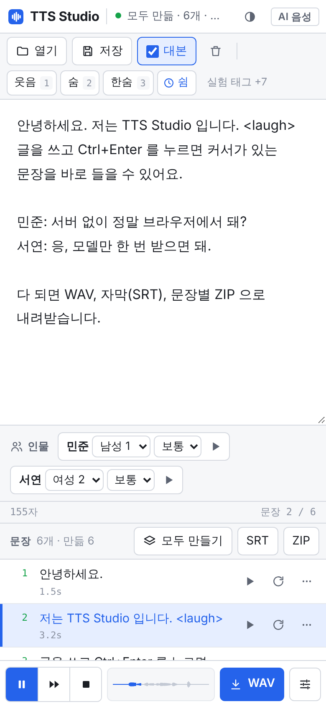

# TTS Studio

글을 넣으면 음성으로 읽어 주고, 문장별로 다듬어 WAV·자막으로 내보내는 브라우저용 음성 합성 도구입니다.

**👉 바로 쓰기: https://themakerrobot.github.io/tts-studio/**

- **설치·가입 없음** — 주소만 열면 PC·휴대폰 모두 됩니다. 휴대폰은 브라우저 메뉴의 `홈 화면에 추가` 로 앱처럼 쓸 수 있습니다.
- **내 기기에서 합성** — 음성은 브라우저 안에서 만들고, 글은 서버로 보내지 않습니다. 한 번 연 뒤에는 인터넷 없이도 열립니다.
- **31개 언어** — 음성 모델 [Supertonic 3](https://huggingface.co/supertone-oss-archive/supertonic-3)의 공식 지원 언어입니다.
- **처음 한 번만 내려받기** — 첫 실행 때 음성 모델을 받고(휴대폰용 8비트 177MB, PC용 32비트 379MB), 그다음부터는 브라우저에 저장된 모델을 씁니다. 기기에는 지금 쓰는 모델 1개만 저장합니다.


<p>
  
  
</p>

## 주요 기능

| 기능 | 내용 |
|---|---|
| 바로 듣기 | `Ctrl+Enter` 로 커서가 있는 문장을 듣습니다. 글을 선택했으면 선택한 부분만 듣습니다. 재생 중에 재생 버튼을 누르면 일시정지됩니다. |
| 긴 글 | 글을 문장 단위로 나눠 목록으로 보여 주고, 커서부터 끝까지 이어 읽습니다. 빈 줄은 문단 쉼이 됩니다. |
| 쉼 넣기 | 글 안에 `[1초]` `[0.5초]` `[500ms]` 처럼 쓰면 그 자리에서 쉽니다. 툴바의 `쉼` 버튼으로 넣을 수 있습니다. |
| 읽기 사전 | `TTS → 티티에스` 처럼 적어 두면 글은 그대로 두고 읽을 때만 바꿉니다. |
| 다시 뽑기 | 마음에 안 드는 문장만 ↻ 로 다시 만듭니다. 최근 3개를 후보 `1` `2` `3` 으로 남겨 두어 앞의 소리로 돌아갈 수 있습니다. |
| 문장별 설정 | 문장 목록의 `⋯` 로 그 문장만 목소리·빠르기·뒤 쉼을 바꾸고, 그 문장 WAV 를 저장합니다. |
| 대본 모드 | `대본` 을 켜고 `철수: 안녕?` 처럼 쓰면 인물마다 목소리·나이를 따로 줄 수 있습니다. |
| 표현 태그 | 웃음·숨·한숨 버튼을 누르면 커서 자리에 태그가 들어갑니다. 실험 태그 7개가 더 있습니다. |
| 파일 열기 | `.txt` `.md` `.srt` `.vtt` `.json`(프로젝트), 3MB 이하. 쓰던 글이 있으면 `바꾸기` / `끝에 붙이기` 를 묻고, `Ctrl+Z` 로 되돌릴 수 있습니다. |
| 프로젝트 저장 | 툴바의 `저장` 으로 글·인물·사전·문장별 설정·다시 뽑은 소리를 `.json` 하나로 저장하고, `열기` 로 다시 불러옵니다. |
| 내보내기 | 전체 `WAV`, 전체 WAV 와 시간이 맞는 자막 `SRT`, 문장별 WAV 를 묶은 `ZIP`(파일 이름에 문장 앞부분, 예: `001_민준_서버_없이_정말_돼.wav`). |

## 쓰는 법

1. 위 주소를 엽니다. 위쪽 표시등이 초록색으로 바뀌고 `준비 · …` 가 뜨면 쓸 수 있습니다.
2. 설정에서 언어와 목소리를 고릅니다. 목소리 옆 ▶ 버튼으로 고른 언어의 문장을 미리 들어 볼 수 있습니다.
3. 가운데 편집기에 글을 쓰거나 붙여 넣습니다. 파일은 `열기` 로 엽니다.
4. `Ctrl+Enter` 또는 아래 재생 버튼으로 들어 봅니다. 오른쪽 문장 목록에서 문장별로 듣거나 다시 뽑습니다.
5. 아래 막대의 `WAV` · `SRT` · `ZIP` 으로 내려받습니다. `모두 만들기`·내보내기 중에도 다른 문장을 들을 수 있고, `Esc` 로 멈춥니다.

휴대폰에서는 아래 막대 오른쪽 끝 버튼으로 설정을 엽니다. `SRT` · `ZIP` 은 문장 목록 위쪽에 있습니다.

설정과 글은 이 브라우저에 자동 저장됩니다. 다른 기기로 옮기거나 여러 작업을 나눠 두려면 `저장` 으로 프로젝트 파일을 만드세요. 위쪽 ◐ 버튼으로 화면 테마(자동 · 밝게 · 어둡게)를 바꿉니다.

## 언어

한국어, English, 日本語 등 31개 언어를 고를 수 있습니다. 목록 맨 위의 `언어 미지정 (na)` 은 언어를 정하지 않고 읽는 옵션입니다. 언어를 알아내 맞춰 주는 기능은 아니므로, 글의 언어를 알면 그 언어를 고르는 편이 정확합니다.

## 설정

| 묶음 | 항목 | 내용 |
|---|---|---|
| 목소리 | 언어 | 31개 언어 + 언어 미지정 |
| | 목소리 | 여성 5 · 남성 5 |
| | 나이 | 아이 · 보통 · 어른 · 노인. 목소리 높이와 말 빠르기를 함께 바꿉니다. |
| | 프리셋 | 지금 설정을 이름 붙여 저장하고 불러옵니다. |
| 소리 | 빠르기 | 0.5 ~ 2배 |
| | 음 높이 | 0.85 ~ 1.15배 |
| | 품질 단계 | 1 ~ 32 (기본 8). 높을수록 깨끗하고 느립니다. |
| | 시드 | 비우면 문장마다 따로 정합니다. 숫자를 넣으면 모든 문장에 같은 값을 씁니다. 같은 시드면 같은 소리가 납니다. |
| | 표현 태그 | 자동 · 항상 그대로 · 두 번 겹쳐 강조 · 모두 빼고 읽기 |
| 읽기 사전 | 항목 | `원래 글 → 읽을 말`. 영문은 대소문자를 가리지 않고 단어 단위로 바꿉니다. 편집기에서 단어를 선택한 채 `항목 추가` 를 누르면 그 단어가 들어갑니다. |
| 출력 | 문장 쉼 · 문단 쉼 | 0 ~ 3초 |
| | 음량 | 0.3 ~ 2배. 자동 맞춤을 켜면 가장 큰 소리를 −0.5dB 에 맞춥니다. |
| | 저장 형식 | WAV 44.1kHz / 24kHz / 16kHz, 16bit |
| 엔진 | 모델 | 자동 · 32비트(379MB) · 8비트(177MB) · 공식 원본(379MB). 지금 쓰는 모델에 `사용 중` 이 붙습니다. |
| | 실행 방식 | 자동 · WebGPU · WASM |

## 단축키

| 키 | 하는 일 |
|---|---|
| `Ctrl` + `Enter` | 커서가 있는 문장 듣기 (선택했으면 선택한 글) |
| `Ctrl` + `Shift` + `Enter` | 커서부터 끝까지 듣기 |
| `Esc` | 멈춤 (모두 만들기·내보내기도 멈춤) |
| `Ctrl` + `S` | 전체 WAV 저장 |
| `Ctrl` + `Shift` + `S` | 프로젝트 저장 (.json) |
| `Ctrl` + `O` | 파일 열기 |
| `Alt` + `R` | 커서가 있는 문장 다시 뽑기 |
| `Alt` + `1` ~ `0` | 표현 태그 넣기 (버튼 오른쪽 숫자) |
| 문장 목록에서 `↑` `↓` · `Enter` | 문장 이동 · 듣기 |
| `?` | 단축키·안내 보기 (편집기 밖에서) |

Mac 은 `Ctrl` 대신 `⌘`, `Alt` 대신 `⌥` 입니다.

## 쉼 넣기

글 안에 쉼 표기를 쓰면 그 자리에서 쉽니다. 툴바의 `쉼` 버튼을 누르면 커서 자리에 `[1초]` 가 들어가고 숫자가 선택되어 있어서 바로 고쳐 쓰면 됩니다.

```
오늘의 문제입니다. [2초] 정답은 바로 로봇입니다!
천천히 따라 해 보세요. 하나, [0.5초] 둘, [0.5초] 셋.
```

- `[1초]` `[0.5초]` `[1.5s]` `[500ms]` 를 알아듣습니다. 최대 10초.
- 문장 끝의 쉼은 그 문장에 붙습니다. 자막(SRT)에는 쉼 표기가 나오지 않습니다.
- 문장 사이 쉼 전체를 바꾸려면 설정 › 출력 › 문장 쉼, 한 문장 뒤만 바꾸려면 문장 목록의 `⋯` › 뒤 쉼.

## 읽기 사전

영문 약어·제품명·숫자처럼 원하는 대로 읽히지 않는 말을 등록합니다. 글은 그대로 두고 읽을 때만 바꾸므로 자막과 대본 파일에는 원래 글이 남습니다.

| 원래 글 | 읽을 말 |
|---|---|
| `TTS` | `티티에스` |
| `PiBrain` | `파이브레인` |
| `ESP32` | `이에스피 삼십이` |

- 영문은 단어 단위로 바꿉니다. `TTS` 를 등록해도 `TTSS` 안의 TTS 는 바꾸지 않습니다.
- 사전은 이 브라우저에 저장되고, 프로젝트 파일에도 함께 들어갑니다.

## 다시 뽑기와 문장별 설정

- ↻ 를 누를 때마다 새 소리를 만들고, 최근 3개를 문장 아래 `1` `2` `3` 후보로 남깁니다. 후보 번호를 누르면 그 소리로 돌아가 들려줍니다.
- `⋯` 를 누르면 그 문장만의 목소리·빠르기·뒤 쉼을 고르고, 그 문장 WAV 를 저장할 수 있습니다. 바꾼 문장은 번호 아래에 점이 붙고, `기본으로` 로 되돌립니다.

## 대본 모드

편집기 위 `대본` 을 켜고 줄을 `이름: 대사` 형식으로 쓰면, 편집기 아래에 인물마다 목소리·나이를 고르는 칸이 생깁니다.

```
두 사람이 마주 앉았습니다.
민준: 오늘 녹음 준비됐어?
서연: 응, 바로 시작하자.
```

- 이름이 없는 줄(위 첫 줄)은 설정의 기본 목소리로 읽습니다.
- 새 인물은 기본 목소리와 겹치지 않게 남성·여성 목소리를 번갈아 받습니다. 바꾼 값은 기억합니다.
- `이름: 대사` 줄이 하나도 없으면 안내와 `예시 넣기` 버튼이 나옵니다.

## 표현 태그

공식 태그는 웃음 `<laugh>` · 숨 `<breath>` · 한숨 `<sigh>` 3개입니다. 모델에서도 **실험 기능**이라 늘 잘 되지는 않습니다.

- 문장 **처음이나 끝**에 두세요. 문장 중간에서는 잘 안 됩니다.
- 소리 대신 태그를 글자로 읽으면, 그 문장만 다시 뽑거나 설정 › 소리 › 표현 태그를 `두 번 겹쳐 강조` 로 바꿔 보세요.
- 태그 학습 데이터가 주로 한국어·영어·일본어입니다. 기본값 `자동` 은 한국어·영어·일본어·언어 미지정에서만 태그를 쓰고, 그 밖의 언어에서는 태그를 빼고 읽습니다. 다른 언어에서도 쓰려면 `항상 그대로` 로 바꾸세요.
- `실험 태그 +7` 을 누르면 헛기침 `<clear-throat>` · 기침 `<cough>` · 재채기 `<sneeze>` · 훌쩍 `<sniff>` · 끙 `<groan>` · 하품 `<yawn>` · 음… `<hmm>` 이 점선 버튼으로 나옵니다. 공식 문서에 없는 목록이라 효과가 없거나 글자로 읽힐 수 있습니다.

## 잘 쓰는 요령

- 처음에는 품질 단계 8 로 빠르게 맞추고, 다 정해지면 16 ~ 32 로 올린 뒤 `모두 만들기` → 내려받기.
- 시드를 비워 두면 같은 문장은 늘 같은 소리로 나옵니다. 전체 분위기를 바꾸려면 시드 옆 무작위 버튼을 누르세요.
- 휴대폰에서 느리면 설정 › 엔진에서 모델 `8비트`, 실행 방식 `WASM` 으로 바꾸세요.
- 모델을 바꾸면 페이지를 다시 불러오고 새 모델을 받습니다. 기기에는 모델 1개만 두므로 이전 모델은 지워지고, 다시 돌아가면 다시 받습니다. 저장 공간을 비우려면 설정 › 엔진 › `받은 모델 지우기`.

## 사용 조건

- 만든 음성은 **AI 음성**입니다. 쓸 때 AI 가 만든 음성임을 밝혀 주세요.
- 실제 사람을 흉내 내거나 속이는 데, 허위 정보나 불법 용도로 쓰면 안 됩니다(모델 라이선스 Open RAIL-M 의 사용 제한).
- 음성 모델은 Supertone Inc. 의 Supertonic 3 입니다. 이 프로젝트는 Supertone Inc. 와 관계가 없습니다.

## 라이선스 · 문서

- 코드: [MIT](LICENSE)
- 음성 모델·포함된 구성 요소: 각자의 라이선스를 따릅니다 → [THIRD_PARTY_NOTICES.md](THIRD_PARTY_NOTICES.md)
- 구조·엔진·모델 위치·로컬 실행: [docs/TECHNICAL.md](docs/TECHNICAL.md)
