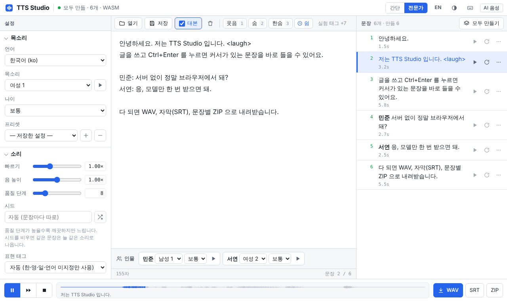
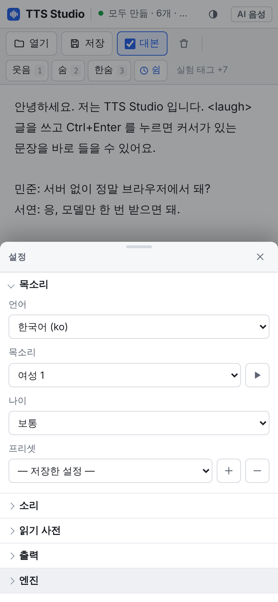

# TTS Studio

글을 넣으면 음성으로 읽어 주고, 문장별로 다듬어 WAV·자막으로 내보내는 브라우저용 음성 합성 도구입니다.

**👉 바로 쓰기: https://themakerrobot.github.io/tts-studio/**

- **설치·가입 없음** — 주소만 열면 PC·휴대폰 모두 됩니다.
- **내 기기에서 합성** — 음성은 브라우저 안에서 만들고, 글은 서버로 보내지 않습니다.
- **31개 언어** — 음성 모델 [Supertonic 3](https://huggingface.co/supertone-oss-archive/supertonic-3)의 공식 지원 언어입니다.
- **처음 한 번만 내려받기** — 첫 실행 때 음성 모델을 받고(휴대폰용 8비트 약 177MB), 그다음부터는 브라우저에 저장된 모델을 씁니다.

  
  

## 주요 기능

| 기능 | 내용 |
|---|---|
| 바로 듣기 | `Ctrl+Enter` 로 커서가 있는 문장을 듣습니다. 글을 선택했으면 선택한 부분만 듣습니다. |
| 긴 글 | 글을 문장 단위로 나눠 목록으로 보여 주고, 커서부터 끝까지 이어 읽습니다. 빈 줄은 문단 쉼이 됩니다. |
| 다시 뽑기 | 마음에 안 드는 문장만 ↻ 버튼으로 다시 만듭니다. 고른 결과는 기억합니다. |
| 파일 열기 | `.txt` `.md` `.srt` `.vtt` (3MB 이하). 자막 파일은 자막 시간에 맞춰 이어 붙입니다. |
| 대본 모드 | `철수: 안녕?` 처럼 쓰면 인물마다 목소리·나이를 따로 줄 수 있습니다. |
| 표현 태그 | 웃음·숨·한숨 버튼을 누르면 커서 자리에 태그가 들어갑니다. 실험 태그 7개가 더 있습니다. |
| 내보내기 | 전체 `WAV`, 전체 WAV 와 시간이 맞는 자막 `SRT`, 문장별 WAV 를 묶은 `ZIP`. |

## 쓰는 법

1. 위 주소를 엽니다. 위쪽에 `준비 · …` 가 뜨면 쓸 수 있습니다.
2. 설정에서 언어와 목소리를 고릅니다. 목소리 옆 ▶ 버튼으로 미리 들어 볼 수 있습니다.
3. 가운데 편집기에 글을 쓰거나 붙여 넣습니다. 파일은 `열기` 로 엽니다.
4. `Ctrl+Enter` 또는 아래 재생 버튼으로 들어 봅니다. 오른쪽 문장 목록에서 문장별로 듣거나 다시 뽑습니다.
5. 아래 막대의 `WAV` · `SRT` · `ZIP` 으로 내려받습니다.

휴대폰에서는 아래 막대 오른쪽 끝 버튼으로 설정을 엽니다. `SRT` · `ZIP` 은 문장 목록 위쪽에 있습니다.

설정과 글은 이 브라우저에 자동 저장됩니다.

## 언어

한국어, English, 日本語 등 31개 언어를 고를 수 있습니다. 목록 맨 위의 `언어 미지정 (na)` 은 언어를 정하지 않고 읽는 옵션입니다. 언어를 알아내 맞춰 주는 기능은 아니므로, 글의 언어를 알면 그 언어를 고르는 편이 정확합니다.

## 설정

| 묶음 | 항목 | 내용 |
|---|---|---|
| 목소리 | 언어 | 31개 언어 + 언어 미지정 |
| | 목소리 | 여성 5 · 남성 5 |
| | 나이 | 아이 · 보통 · 어른 · 노인. 목소리 높이와 말 빠르기를 함께 바꿉니다. |
| | 프리셋 | 지금 설정을 이름 붙여 저장하고 불러옵니다. |
| 소리 | 빠르기 | 0.5 ~ 2배 |
| | 음 높이 | 0.85 ~ 1.15배 |
| | 품질 단계 | 1 ~ 32 (기본 8). 높을수록 깨끗하고 느립니다. |
| | 시드 | 비우면 문장마다 따로 정합니다. 숫자를 넣으면 모든 문장에 같은 값을 씁니다. 같은 시드면 같은 소리가 납니다. |
| | 표현 태그 | 자동 · 항상 그대로 · 두 번 겹쳐 강조 · 모두 빼고 읽기 |
| 출력 | 문장 쉼 · 문단 쉼 | 0 ~ 3초 |
| | 음량 | 0.3 ~ 2배. 자동 맞춤을 켜면 가장 큰 소리를 −0.5dB 에 맞춥니다. |
| | 저장 형식 | WAV 44.1kHz / 24kHz / 16kHz, 16bit |
| 엔진 | 모델 | 자동 · 32비트 · 8비트 · 공식 원본 |
| | 실행 방식 | 자동 · WebGPU · WASM |

## 단축키

| 키 | 하는 일 |
|---|---|
| `Ctrl` + `Enter` | 커서가 있는 문장 듣기 (선택했으면 선택한 글) |
| `Ctrl` + `Shift` + `Enter` | 커서부터 끝까지 듣기 |
| `Esc` | 멈춤 |
| `Ctrl` + `S` | 전체 WAV 저장 |
| `Ctrl` + `O` | 파일 열기 |
| `Alt` + `R` | 커서가 있는 문장 다시 뽑기 |
| `Alt` + `1` ~ `0` | 표현 태그 넣기 (버튼 오른쪽 숫자) |
| `?` | 단축키 보기 (편집기 밖에서) |

Mac 은 `Ctrl` 대신 `⌘`, `Alt` 대신 `⌥` 입니다.

## 표현 태그

공식 태그는 웃음 `<laugh>` · 숨 `<breath>` · 한숨 `<sigh>` 3개입니다. 모델에서도 **실험 기능**이라 늘 잘 되지는 않습니다.

- 문장 **처음이나 끝**에 두세요. 문장 중간에서는 잘 안 됩니다.
- 소리 대신 태그를 글자로 읽으면, 그 문장만 다시 뽑거나 설정 › 소리 › 표현 태그를 `두 번 겹쳐 강조` 로 바꿔 보세요.
- 태그 학습 데이터가 주로 한국어·영어·일본어입니다. 기본값 `자동` 은 한국어·영어·일본어·언어 미지정에서만 태그를 쓰고, 그 밖의 언어에서는 태그를 빼고 읽습니다. 다른 언어에서도 쓰려면 `항상 그대로` 로 바꾸세요.
- `실험 태그 +7` 을 누르면 헛기침 `<clear-throat>` · 기침 `<cough>` · 재채기 `<sneeze>` · 훌쩍 `<sniff>` · 끙 `<groan>` · 하품 `<yawn>` · 음… `<hmm>` 이 점선 버튼으로 나옵니다. 공식 문서에 없는 목록이라 효과가 없거나 글자로 읽힐 수 있습니다.

## 잘 쓰는 요령

- 처음에는 품질 단계 8 로 빠르게 맞추고, 다 정해지면 16 ~ 32 로 올린 뒤 `모두 만들기` → 내려받기.
- 시드를 비워 두면 같은 문장은 늘 같은 소리로 나옵니다. 전체 분위기를 바꾸려면 시드 옆 무작위 버튼을 누르세요.
- 휴대폰에서 느리면 설정 › 엔진에서 모델 `8비트`, 실행 방식 `WASM` 으로 바꾸세요.
- 엔진을 바꾸면 페이지를 다시 불러옵니다. 내려받은 모델은 설정 › 엔진 › `받은 모델 지우기` 로 지웁니다.

## 사용 조건

- 만든 음성은 **AI 음성**입니다. 쓸 때 AI 가 만든 음성임을 밝혀 주세요.
- 실제 사람을 흉내 내거나 속이는 데, 허위 정보나 불법 용도로 쓰면 안 됩니다(모델 라이선스 Open RAIL-M 의 사용 제한).
- 음성 모델은 Supertone Inc. 의 Supertonic 3 입니다. 이 프로젝트는 Supertone Inc. 와 관계가 없습니다.

## 라이선스 · 문서

- 코드: [MIT](LICENSE)
- 음성 모델·포함된 구성 요소: 각자의 라이선스를 따릅니다 → [THIRD_PARTY_NOTICES.md](THIRD_PARTY_NOTICES.md)
- 구조·엔진·모델 위치·로컬 실행: [docs/TECHNICAL.md](docs/TECHNICAL.md)
