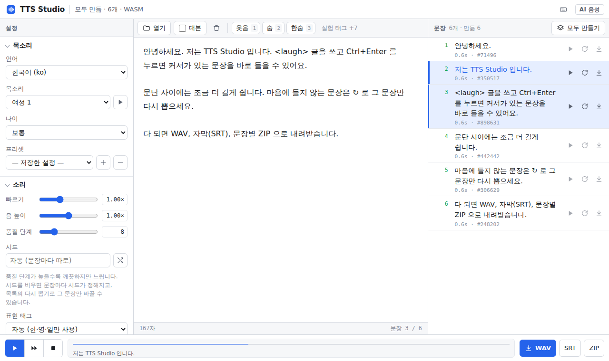
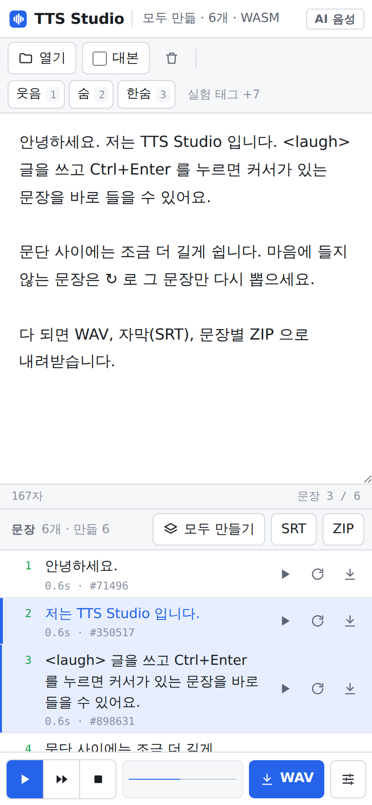
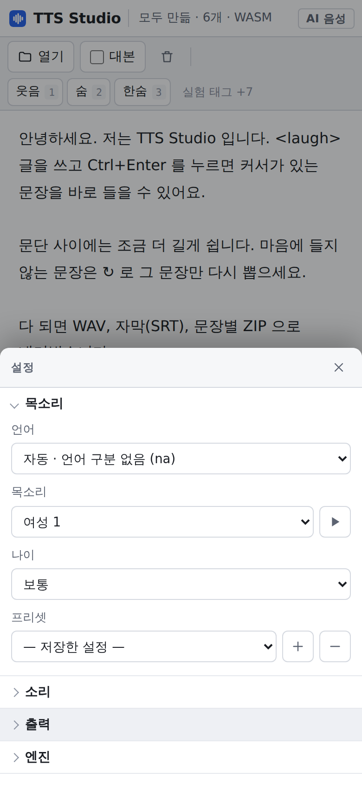

# TTS Studio

**글을 넣으면 31개 언어 음성으로 읽어 주고, 문장별로 다듬어 WAV·자막으로 내려받는 도구입니다.**
설치도 가입도 필요 없고, 음성은 내 기기(브라우저) 안에서 만들어서 글이 서버로 가지 않습니다.

### 👉 바로 쓰기: **https://themakerrobot.github.io/tts-studio/**

PC·휴대폰 모두 됩니다. 처음 한 번 음성 모델을 내려받고(휴대폰은 약 177MB), 그다음부터는 브라우저에 저장된 모델을 씁니다.

  
  

## 이런 걸 할 수 있어요
- **한 문장 바로 듣기** — 쓰다가 `Ctrl+Enter` 면 커서가 있는 문장을 바로 들려줍니다. 글을 선택했으면 선택한 부분만.
- **긴 글 한 번에** — 문장마다 나눠 목록으로 보여 주고, 커서부터 끝까지 이어서 읽습니다. 빈 줄은 문단 쉼.
- **문장별로 다시 뽑기** — 마음에 안 드는 문장만 다시 뽑기 버튼(↻ 모양)으로 다른 소리로 다시 만듭니다. 고른 소리는 기억해 둡니다.
- **파일 열기** — `.txt` `.md` `.srt` `.vtt`. 자막 파일은 자막 시간에 맞춰 이어 붙입니다.
- **대본 모드** — `철수: 안녕?` 처럼 쓰면 인물마다 다른 목소리·나이를 줄 수 있습니다.
- **표현 태그** — 웃음·숨·한숨 버튼(+ 실험 태그 7개). 누르면 커서 자리에 들어갑니다.
- **내려받기** — 전체 WAV, 전체 WAV 와 시간이 맞는 자막(SRT), 문장별 WAV 를 묶은 ZIP.
- **31개 언어 + 자동** — 한국어, English, 日本語 등 31개. `자동`은 언어를 정하지 않고 읽습니다.

## 쓰는 법
1. 위 주소를 엽니다. 위쪽에 `준비 · …` 가 뜨면 쓸 수 있습니다.
2. 언어와 목소리를 고릅니다. 목소리 옆 재생 버튼으로 미리 들어 볼 수 있습니다.
3. 가운데에 글을 쓰거나 붙여 넣거나 `열기` 로 파일을 엽니다.
4. `Ctrl+Enter` 또는 아래 재생 버튼으로 들어 보고, 오른쪽 문장 목록에서 문장별로 듣거나 다시 뽑기를 합니다.
5. 아래 막대의 `WAV` · `SRT` · `ZIP` 으로 내려받습니다.

휴대폰에서는 설정이 아래 막대 오른쪽 끝 버튼 안에 있고, SRT·ZIP 은 문장 목록 위쪽에 있습니다.

## 설정
| 항목 | 내용 |
|---|---|
| 목소리 | 여성 5 · 남성 5 |
| 나이 | 아이 · 보통 · 어른 · 노인 (목소리 높이와 말 빠르기를 함께 조정) |
| 빠르기 | 0.5 ~ 2배 |
| 음 높이 | 0.85 ~ 1.15배 미세 조정 |
| 품질 단계 | 1 ~ 32. 높을수록 깨끗하고 느립니다 (기본 8) |
| 시드 | 비우면 문장마다 따로 정해지고, 숫자를 넣으면 모든 문장에 같은 값. 같은 시드 = 같은 소리 |
| 문장 쉼 · 문단 쉼 | 0 ~ 3초 |
| 음량 | 0.3 ~ 2배, 자동 맞춤(가장 큰 소리를 −0.5dB 에 맞춤) |
| 저장 형식 | WAV 44.1kHz / 24kHz / 16kHz, 16bit |
| 프리셋 | 지금 설정을 이름 붙여 저장하고 불러오기 |
| 엔진 | 모델(자동 / 32비트 / 8비트 / 공식 원본), 실행 방식(자동 / WebGPU / WASM) |

설정과 글은 이 브라우저에 자동 저장됩니다.

## 단축키
| 키 | 하는 일 |
|---|---|
| `Ctrl` + `Enter` | 커서가 있는 문장 듣기 (선택했으면 선택한 글) |
| `Ctrl` + `Shift` + `Enter` | 커서부터 끝까지 듣기 |
| `Esc` | 멈춤 |
| `Ctrl` + `S` | 전체 WAV 저장 |
| `Ctrl` + `O` | 파일 열기 |
| `Alt` + `R` | 커서 문장 다시 뽑기 |
| `Alt` + `1` ~ `0` | 표현 태그 넣기 |
| `?` | 단축키 보기 (편집기 밖에서) |

Mac 은 `Ctrl` 대신 `⌘`, `Alt` 대신 `⌥`.

## 표현 태그
웃음 `<laugh>` · 숨 `<breath>` · 한숨 `<sigh>` 3개가 공식 태그입니다. 버튼 오른쪽 숫자가 `Alt` + 숫자 단축키입니다.

태그는 모델에서도 **실험 기능**이라 늘 잘 되지는 않습니다.
- 문장 **처음이나 끝**에 두세요. 문장 중간에서는 잘 안 됩니다.
- 소리 대신 태그를 글자로 읽을 때가 있습니다. 그 문장만 다시 뽑거나, 설정 › 소리 › 표현 태그를 `두 번 겹쳐 강조`로 바꿔 보세요.
- 태그 학습 데이터가 주로 한국어·영어·일본어라, 그 밖의 언어에서는 기본값(`자동`)일 때 태그를 빼고 읽습니다. `항상 그대로`로 바꿀 수 있습니다.
- `실험 태그 +7`을 누르면 헛기침 `<clear-throat>` · 기침 `<cough>` · 재채기 `<sneeze>` · 훌쩍 `<sniff>` · 끙 `<groan>` · 하품 `<yawn>` · 음… `<hmm>`이 나옵니다(점선 버튼). 공식 문서에 없는 목록이라 효과가 없거나 글자로 읽힐 수 있습니다.

## 잘 쓰는 요령
- 처음엔 품질 단계 8 로 빠르게 맞춰 보고, 다 정해지면 16~32 로 올려 `모두 만들기` → 내려받기.
- 같은 문장이 매번 똑같이 나와야 하면 시드를 비워 두세요(문장마다 고정). 전체 분위기를 바꾸고 싶으면 시드 옆 무작위 버튼.
- 휴대폰이 느리면 엔진 → 모델 `8비트`, 실행 `WASM`.
- 엔진을 바꾸면 페이지를 다시 불러옵니다. 내려받은 모델을 지우려면 엔진 → `받은 모델 지우기`.

## 꼭 지켜 주세요
- 만든 음성은 **AI 음성**입니다. 쓸 때 AI 가 만든 음성임을 밝혀 주세요.
- 실제 사람을 흉내 내거나 속이는 데, 허위 정보나 불법 용도로 쓰면 안 됩니다(모델 라이선스 Open RAIL-M 사용 제한).
- 음성 모델은 Supertone Inc. 의 [Supertonic 3](https://huggingface.co/supertone-oss-archive/supertonic-3) 입니다. 이 프로젝트는 Supertone Inc. 와 관계가 없습니다.
- 이 프로젝트 코드는 [MIT](LICENSE)입니다. 음성 모델과 포함된 구성 요소는 각자의 라이선스를 따릅니다: [THIRD_PARTY_NOTICES.md](THIRD_PARTY_NOTICES.md)
- 기술 문서: [docs/TECHNICAL.md](docs/TECHNICAL.md)
